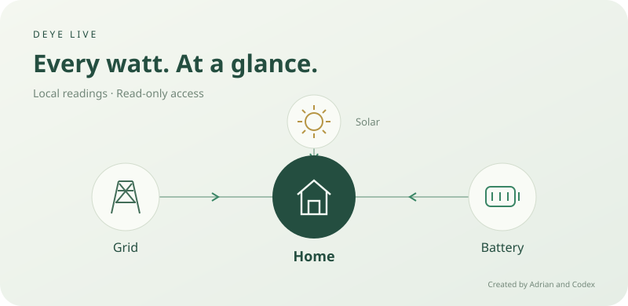

# Deye Live

### Your home's energy, directly from your inverter.

**Created by Adrian and Codex**


Deye Live is a Home Assistant custom integration with a bundled dashboard card.
It connects to a compatible Deye logger over your local network and shows house
consumption, grid import/export, battery power, battery percentage and solar
generation. No Deye Cloud account or Solarman V5 connection is required.

<p align="center"></p>

## At a glance

| Feature | What it does |
| --- | --- |
| Local readings | Polls the inverter every five seconds by default |
| Power-flow card | Shows direction of energy flow, power in W/kW and battery level |
| Battery limits | Shows charge/discharge current limits, low/shutdown/restart SOC and scheduled targets |
| Honest connection status | Clears readings when offline; marks old snapshots delayed and stops animations |
| Simple installation | One HACS integration includes both sensors and the card |
| Fits your dashboard | Light/dark themes, responsive layout, English and Traditional Chinese |
| Accessible | Keyboard navigation and reduced-motion support |
| Read-only operation | No inverter controls, write services, clock changes or firmware updates |

## Compatibility

**Hardware-tested:** Deye **SUN-5K-SG04LP1-AU** with a **DYDA_WiBLE_1.7.2** logger,
using standard **Modbus TCP on port 502**, unit **1**.

**Home Assistant tested:** Core **2026.9.1**. This is an early custom release,
not an official Deye or Home Assistant integration.

The decoder uses the single-phase **SG0xLP1** register layout. Do not use it for
three-phase, high-voltage or different register-map variants. Other models in
the same family are not independently hardware-verified.

The logger must already provide a local Modbus TCP service. Some WiBLE loggers
expose this through **Link2 → Modbus TCP**. This integration does not enable or
reconfigure the logger. Its existing cloud connection can remain in place.

## Install with HACS

1. Open **HACS → ⋮ → Custom repositories**.
2. Add `https://github.com/devbadrian-tech/deye-live` and select **Integration**.
3. Find **Deye Live** in HACS and download it.
4. Restart Home Assistant.
5. Open **Settings → Devices & services → Add integration → Deye Live**.
6. Enter your logger's local IP, TCP port and Modbus unit. Start with **502**,
   **1** and a **5-second** update interval. Leave direction reversal off unless
   your installation uses the opposite sign convention.

Setup checks the inverter family, serial and power registers before accepting
the connection. The serial identifies the device; subsequent polls reject an
unexpected device if the IP address changes.

<details>
<summary>Manual installation</summary>

Copy `custom_components/deye_live` into the `custom_components` directory in your
Home Assistant configuration folder, then restart HA and add the integration.
The resulting path must be `/config/custom_components/deye_live/manifest.json`.
Some File editor installations display `/homeassistant` instead of `/config`.

</details>

## Add the card

Refresh your browser after adding the integration. Edit a dashboard, choose
**Add card → Deye Live**, then select the **Live snapshot** sensor for your inverter.
The visual editor lets you set a title and show/hide solar and battery limits.

The integration serves and registers the card automatically. You normally do
not need a second HACS download or a manual dashboard resource.

```yaml
type: custom:deye-live-card
entity: sensor.deye_live_XXXX_live_snapshot
title: Home energy
show_solar: true
show_limits: true
```

Replace `XXXX` with the actual entity ID shown in Home Assistant. If a customized
frontend prevents automatic loading, register `/deye_live/deye-live-card.js?v=0.1.0&dashboard=1`
as a **JavaScript module** under Dashboard Resources, then refresh the browser.

## Understanding the readings

- **House:** current load power.
- **Grid:** positive means importing; negative means exporting.
- **Battery:** positive means discharging; negative means charging.
- **Solar:** combined PV1 and PV2 power.
- **Battery level:** the inverter's reported state of charge.

Direction-reversal options only change how values are interpreted. They do not
change inverter operation. Battery discharge has been observed on the tested
hardware. Charging and grid import/export directions are covered by synthetic
tests but have not all been exercised on that hardware.

Power values need not balance exactly: conversion losses and measurement timing
can produce differences. The sensors report power, not cumulative energy; they
are not kWh meters for the Home Assistant Energy dashboard.

### Battery limits are distinct settings

| Displayed value | Meaning |
| --- | --- |
| Maximum charge/discharge current | Configured inverter current limit in amperes |
| Low battery | Configured low-SOC threshold |
| Shutdown | Configured shutdown SOC |
| Restart | Configured restart SOC |
| Scheduled targets | Lowest/highest SOC target and the six configured schedule slots |

**A scheduled SOC target is not a hard maximum-charge protection.** Battery BMS
limits and other operating settings may impose additional constraints. This
release does not claim to read every protection or the instantaneous effective
BMS current allowance. All these settings are displayed read-only.

## What “Live” means

The card uses a timestamp from each successful local response, even when power
values remain unchanged. It does not rely on the sensor's `last_changed` value.

- A failed power poll marks entities unavailable and clears the current values.
- If updates stop, the last sample is marked delayed after three poll intervals
  (at least 15 seconds), and flow animations stop.
- Limits are read once a minute. Missing optional limits do not hide valid power
  readings, and the card rejects limit data older than three minutes.
- Missing readings display a dash, never a fabricated zero.

The logger does not expose the inverter's measurement acquisition timestamp.
“Live” therefore means a fresh local reply; internal logger caching cannot be
independently timed. Sequential register reads are not an atomic snapshot.

## Read-only by design

Every integration request is a Modbus **function 03 read**. The bundled transport
rejects write functions before opening a connection and validates transaction,
unit, function, byte count and response length. It also supports read function 04
for transport tests, but the integration itself uses 03 only.

No control entities or write services are registered. No cloud login, analytics
or telemetry upload is included. Modbus TCP itself is an unencrypted local
protocol; keep it on your trusted LAN and do not expose port 502 to the internet.

## Troubleshooting

| Symptom | Check |
| --- | --- |
| Cannot connect | Logger IP, port, Modbus service and HA's network route to the logger |
| Unsupported device | The device must use the supported SG0xLP1 register profile |
| Card is missing | Refresh the browser after integration setup; check the resource instructions above |
| Power direction is reversed | Compare with the inverter display and adjust the relevant integration option |
| Battery limits show a dash | That field may be unsupported, invalid or temporarily unavailable |
| IP address changes | Use a DHCP reservation or update the integration options |

If version 0.1.0 intermittently reports **Custom element doesn't exist:
deye-live-card** after a refresh, edit its Dashboard Resource URL to
`/deye_live/deye-live-card.js?v=0.1.0&dashboard=1` (type: JavaScript module).
The distinct URL makes the dashboard evaluate the card after the frontend is
ready, even if the automatic loader ran too early. No HA restart is needed.
This addresses the [Home Assistant early-module registration race](https://github.com/home-assistant/frontend/issues/53890);
it does not change telemetry or inverter settings. Development builds also wait
for the frontend registry before defining the card and editor.

When reporting a problem, include the inverter model, logger firmware, HA
version and the error text. Remove IPs, serials, credentials and private readings
from anything you publish.

## Development and validation

The offline tests use synthetic data and do not connect to your LAN:

```sh
python3 -m unittest discover -s tests -v
node --test tests/*.test.js
```

Coverage includes protocol framing, rejection of writes, signed decoding,
identity changes, missing optional registers, polling limits, freshness and flow
direction. The initial release was also tested in the official HA 2026.9.1
container with real hardware: setup, **19 sensor entities**, fresh timestamps,
offline handling, recovery, duplicate prevention and unloading passed.

## Register-map references

The single-phase mapping was checked against these primary implementations:

- [SG0xLP1 register definition](https://github.com/davidrapan/ha-solarman/blob/main/custom_components/solarman/inverter_definitions/deye_hybrid.yaml)
- [Deye single-phase reader](https://github.com/kbialek/deye-inverter-mqtt/blob/main/src/deye_sensors_deye_hybrid.py)
- [Home Assistant custom-card documentation](https://contributors.home-assistant.io/frontend/custom-ui/card/)

The illustration above is a diagram, not a capture of household telemetry.
